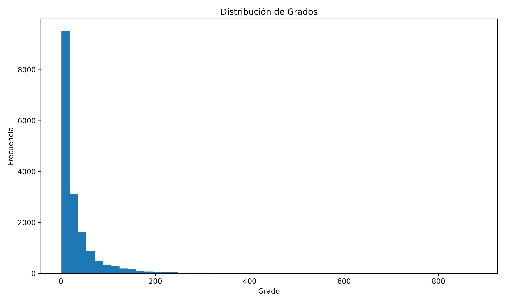
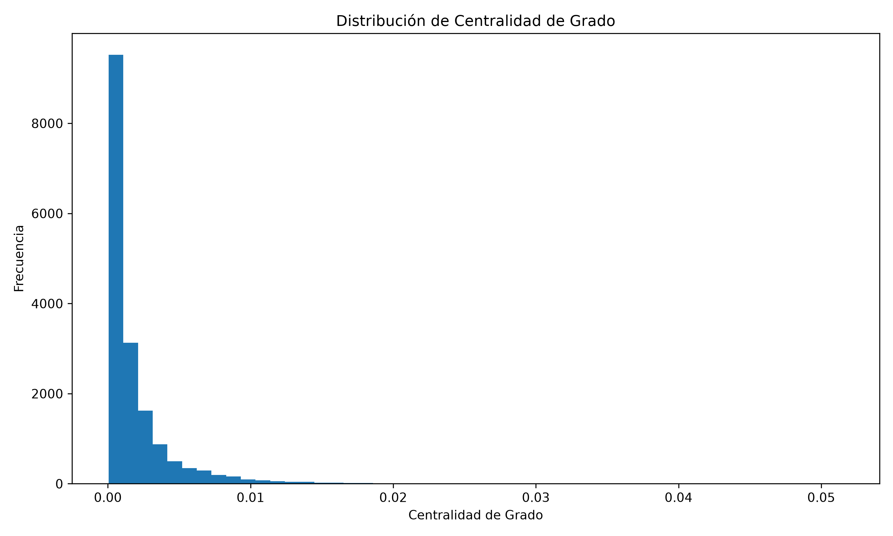
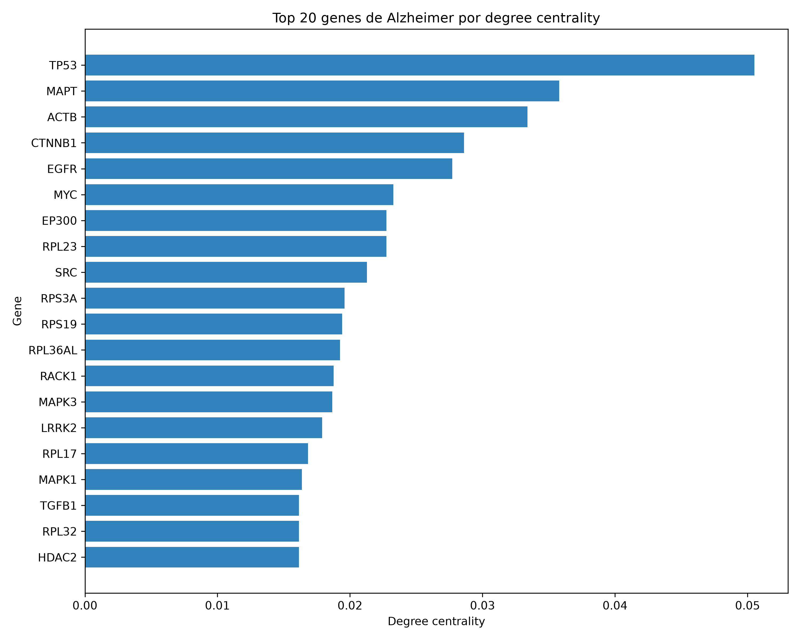

# PPI Drug Repurposing


Exploratory bioinformatics pipeline that uses a protein-protein interaction (PPI) network to prioritize ChEMBL-annotated protein targets for further investigation in Alzheimer's disease. It generates hypotheses for drug repurposing; it does not identify or validate drugs for Alzheimer's disease.

---

## Project Description

**Drug repurposing** means investigating whether existing drugs could be used for a disease they were not designed to treat. This project is an initial target-prioritization analysis in support of that broader goal, not a complete drug-repurposing study.

The working hypothesis is that proteins directly connected in a PPI network to Alzheimer's-associated proteins may be useful targets to investigate. The pipeline checks whether these non-Alzheimer neighbor proteins have single-protein target records in ChEMBL. Network proximity and a ChEMBL record alone do not show that a drug affects Alzheimer's disease.

The pipeline:

1. Builds a human PPI network from STRING.
2. Measures how connected each protein is (degree centrality).
3. Maps OpenTargets Alzheimer-associated genes to the network.
4. Finds their first-degree neighbors that are not in the Alzheimer-associated gene set and checks those proteins for single-protein target records in ChEMBL.

The resulting table prioritizes target records for follow-up. It does not contain evidence that a specific compound is effective or suitable for Alzheimer's disease.

### Scientific background

* **PPI network:** proteins are nodes and interactions are edges. Edges come from STRING and carry its `combined_score`. The pipeline keeps interactions with `combined_score >= 700`.
* **Species:** the STRING files use the `9606` prefix.
* **Degree centrality:** the normalized number of connections of a node, computed with NetworkX on the largest connected component. Proteins with many connections are treated as hubs.
* **Disease association:** OpenTargets provides the genes associated with Alzheimer's disease and their `globalScore`.
* **Drug information:** ChEMBL provides a mapping between UniProt accessions and ChEMBL targets.

---

## Datasets

None of the datasets are included in the repository (`data/` is ignored by Git, except `.gitkeep`). Download them and place them in `data/raw/`.

### STRING

* Version: v12.5
* Files:
  * `9606.protein.links.v12.5.txt.gz`
  * `9606.protein.info.v12.5.txt.gz`
  * `9606.protein.aliases.v12.5.txt.gz`
* Download URLs:

```text
https://stringdb-downloads.org/download/protein.links.v12.5/9606.protein.links.v12.5.txt.gz
https://stringdb-downloads.org/download/protein.info.v12.5/9606.protein.info.v12.5.txt.gz
https://stringdb-downloads.org/download/protein.aliases.v12.5/9606.protein.aliases.v12.5.txt.gz
```

### ChEMBL

* File: `chembl_uniprot_mapping.txt`
* URL: <https://ftp.ebi.ac.uk/pub/databases/chembl/ChEMBLdb/latest/chembl_uniprot_mapping.txt>

### OpenTargets

* Disease: Alzheimer disease (`MONDO_0004975`)
* Data version: v26.09
* Filters (applied on OpenTargets platform before downloading): GWAS + UniProt
* Source: <https://platform.opentargets.org/disease/MONDO_0004975/associations>

The scripts read the associated-targets table from this exact file name, in `data/raw/`:

```text
OT-MONDO_0004975-associated-targets-26_10_2026-v26_09 (2).tsv
```

---

## Project Structure

```text
ppi-drug-repurposing/
│
├── .gitignore
├── environment.yml
│
├── data/
│   ├── .gitkeep
│   ├── raw/
│   │   ├── 9606.protein.aliases.v12.5.txt.gz
│   │   ├── 9606.protein.info.v12.5.txt.gz
│   │   ├── 9606.protein.links.v12.5.txt.gz
│   │   ├── chembl_uniprot_mapping.txt
│   │   └── OT-MONDO_0004975-associated-targets-26_10_2026-v26_09 (2).tsv   # file read by the scripts
│   └── processed/
│       ├── protein_info_csv              # filtered interactions with UniProt IDs and gene names
│       ├── uniprot_map.csv               # UniProt-ChEMBL target mapping
│       ├── degree_centrality.csv         # degree centrality per protein
│       ├── alzheimer_neighbor_targets_with_chembl.csv
│       └── alzheimer_genes_with_drugs.csv  # output from the earlier workflow
│
├── lib/                                  # vis-network, tom-select and bindings
│
├── results/
│   └── figures/
│       ├── alzheimer_subgraph.html
│       ├── alzheimer_top20_degree_centrality.png
│       ├── alzheimer_neighbor_targets.html
│       ├── degree_distribution.png
│       ├── degree_centrality_distribution.png
│       └── top_50_hubs.html
│
└── scripts/
    ├── explore.py                        # loads and filters STRING and ChEMBL files
    ├── grafo.py                          # graph, centrality, top 50 hubs
    ├── drug.py                           # Alzheimer genes x network x ChEMBL
    └── alzheimer_graph.py                # Alzheimer subgraph and top 20 figure
```

---

## Main Results

### Network summary

| Item | Value |
|------|-------|
| Proteins in the STRING info file | 19,698 |
| Interactions in the STRING links file | 10,826,054 |
| Connected components after the `combined_score >= 700` filter | 71 |

The largest component contains almost the whole network.

### Degree distribution

The degree distribution is right-skewed, consistent with a scale-free network topology typical of biological PPI networks.

The scripts save the degree and degree-centrality histograms to the figures folder:





### Top 20 Alzheimer genes by degree centrality



### Interactive Alzheimer graph

Open `results/figures/alzheimer_subgraph.html` in a browser. Download it first, because GitHub shows HTML files as source code.

Node colors:

* Red: top 50 hubs of the network.
* Green: Alzheimer genes with a ChEMBL target.
* Blue: Alzheimer genes without a ChEMBL target.

`results/figures/top_50_hubs.html` shows the subgraph of the top 50 hubs of the whole network.

### Alzheimer-associated proteins and prioritized neighboring targets

This interactive graph shows the top 30 neighboring ChEMBL target proteins by degree centrality and the Alzheimer-associated proteins directly connected to them. Blue nodes are Alzheimer-associated proteins; green diamond nodes are neighboring proteins with a ChEMBL single-protein target record. Hover over a green node to see its ChEMBL ID, target name and degree centrality. This is a visualization of prioritized targets, not of drugs or evidence of therapeutic benefit.

Open [the interactive Alzheimer-neighbor target network](results/figures/alzheimer_neighbor_targets.html) in a browser.
For the current data, this view contains 30 target proteins, 373 directly connected Alzheimer-associated proteins and 1,065 PPI edges.

### Prioritized target records

These records are exploratory leads for target-level follow-up. They should not be interpreted as drugs or as evidence of clinical benefit.

The current data produce 1,891 mapped Alzheimer-gene rows (1,890 unique UniProt proteins) in the network, 10,713 unique non-Alzheimer first-degree neighbors, and 918 ChEMBL single-protein target records (918 unique neighboring proteins). The table shows the top 10 records by degree centrality; this is a network-connectivity ranking, not a therapeutic score.

| uniprot_id | degree_centrality | chembl_id | target_name |
|------------|-------------------|-----------|-------------|
| Q13547 | 0.021987 | CHEMBL325 | Histone deacetylase 1 |
| P46777 | 0.021227 | CHEMBL6066896 | Large ribosomal subunit protein uL18 |
| P42336 | 0.020817 | CHEMBL4005 | Phosphatidylinositol 4,5-bisphosphate 3-kinase catalytic subunit alpha isoform |
| P05231 | 0.019589 | CHEMBL1795129 | Interleukin-6 |
| P32969 | 0.018361 | CHEMBL6066916 | Large ribosomal subunit protein uL6 |
| Q02878 | 0.017952 | CHEMBL6067542 | Large ribosomal subunit protein eL6 |
| Q02543 | 0.017835 | CHEMBL6067541 | Large ribosomal subunit protein eL20 |
| P53350 | 0.017835 | CHEMBL3024 | Serine/threonine-protein kinase PLK1 |
| P46778 | 0.017426 | CHEMBL6066895 | Large ribosomal subunit protein eL21 |
| P49207 | 0.017134 | CHEMBL6066885 | Large ribosomal subunit protein eL34 |

---

## Biological Interpretation

The neighboring-target ranking highlights several proteins of potential interest for further investigation. It can be broadly divided into three groups: proteins with literature-reported links to Alzheimer's disease (Q13547, P05231, and P53350); proteins without a clear direct link identified in this exploratory review (such as P42336); and several ribosomal proteins for which no disease-specific link was identified here.

Q13547, histone deacetylase 1 (HDAC1), has been associated in the literature with Alzheimer's disease and epigenetic dysregulation, including processes related to synaptic changes, amyloid, tau, and cognition. However, the direction and implications of this regulation are not uniform across studies.

P05231, interleukin-6 (IL-6), has been linked to Alzheimer's disease in the context of neuroinflammation and pro-inflammatory signaling. As with HDAC1, the evidence is not uniform, and contradictory findings have been reported.

P53350, serine/threonine-protein kinase PLK1, has a more specific reported association with Alzheimer's disease, focused on neuronal cell-cycle processes and apoptosis.

The interpretation presented here is a learning exercise written as if these computational findings came from a real candidate-prioritization study. It is intended to practice discussing hypothetical results, not to claim that the findings are valid, novel, or clinically meaningful discoveries. They have not been independently validated, and no therapeutic breakthrough is being claimed.

## References

Geng, F., Zhao, N., Chen, X., Liu, X.-T., Zhu, M., Jiang, Y., & Ren, Q. (2023). Transcriptome analysis identifies the role of Class I histone deacetylase in Alzheimer’s disease. Heliyon, 9. https://doi.org/10.1016/j.heliyon.2023.e18008

Schueller, E., Paiva, I., Blanc, F., Wang, X.-L., Cassel, J., Boutillier, A., & Bousiges, O. (2020). Dysregulation of histone acetylation pathways in hippocampus and frontal cortex of Alzheimer's disease patients.. European neuropsychopharmacology : the journal of the European College of Neuropsychopharmacology. https://doi.org/10.1016/j.euroneuro.2020.01.015

Tylutka, A., Żabiński, P., Walas, Ł., & Zembroń-Lacny, A. (2024). Neuroinflammation as a Link in Parkinson’s and Alzheimer’s Diseases: A Systematic Review and Meta-Analysis. Aging and Disease, 16, 3584 - 3600. https://doi.org/10.14336/ad.2024.1174

Long, C., Fritts, A., Broadway, J., Brawman‐Mintzer, O., & Mintzer, J. (2025). Neuroinflammation: A Driving Force in the Onset and Progression of Alzheimer’s Disease. Journal of Clinical Medicine, 14. https://doi.org/10.3390/jcm14020331

Song, B., Davis, K. M., Liu, X., Lee, H.-G., Smith, M., & Liu, X.-Q. (2011). Inhibition of Polo-like kinase 1 reduces beta-amyloid-induced neuronal cell death in Alzheimer's disease. Aging (Albany NY), 3, 846 - 851. https://doi.org/10.18632/aging.100382

---

## Limitations

* This is an exploratory computational analysis. It is not experimental or clinical validation.
* This is a practical learning project: its purpose is to learn and practice bioinformatics libraries and workflows, including data processing, PPI network analysis, and visualization. It is not a validated drug-repurposing study or a clinical resource.

---

## How to Reproduce

> **Note:** the scripts use Windows-style paths. On macOS or Linux, replace `\\` with `/` in the path strings.

### 1. Clone the repository

```bash
git clone https://github.com/moralesgomez-dev/ppi-drug-repurposing.git
cd ppi-drug-repurposing
```

### 2. Create the environment

```bash
conda env create -f environment.yml
conda activate ppi-drug-repurposing
```

### 3. Add the data

Download the files listed in [Datasets](#datasets) and place them in `data/raw/`.
Create the `data/processed/` directory as well; the processing scripts write their tables there.

### 4. Run the scripts

The scripts build their paths from the current working directory, so run them from the project root. Run them in this order:

```powershell
python -m scripts.explore
python -m scripts.grafo
python -m scripts.drug
python -m scripts.alzheimer_graph
```

`drug.py` imports `G_giant` from `scripts.grafo`, so running it also executes `grafo.py`.


Outputs:

* `data/processed/` - processed tables (steps 1 to 3).
* `results/figures/` - figures and interactive graphs (steps 2 and 4).

---

## Author

**AlejandroMoralesGomezDev**

* GitHub: [moralesgomez-dev](https://github.com/moralesgomez-dev)

---

## License

This project is licensed under the [MIT License](./LICENSE).